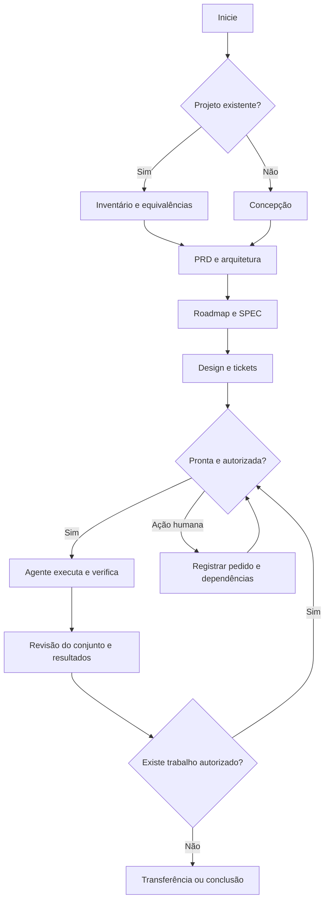

# Fluxo e formatos do framework

As fontes canônicas distribuídas são:
- [Fluxo SDD](../src/sdd_framework/assets/skill/references/WORKFLOW.md)
- [Contratos dos artefatos](../src/sdd_framework/assets/skill/references/ARTIFACTS.md)
- [Política verificável](../src/sdd_framework/assets/policy.json)
- [Templates](../src/sdd_framework/assets/templates/)
- [Skill SDD](../src/sdd_framework/assets/skill/SKILL.md)

Não duplicar esses contratos neste documento. A cópia `.sdd/framework/` é o
snapshot instalado e deve ser atualizada pela CLI quando as fontes mudarem.

## Leitura do fluxo

Revisões podem retornar à etapa que possui a decisão; devem reconciliar os
artefatos afetados. CHECKPOINT registra pausa/retomada; INBOX preserva propostas
não incorporadas. Conferência estrutural pode ser executada em qualquer etapa,
com exigências progressivas e correções por tickets.
